# systemone-flink

[](https://github.com/karthiktiwari061/systemone-flink/actions/workflows/ci.yml)
[](LICENSE)

**Typed decisions for candidate logs in Apache Flink.** Your job does the cheap detection. `systemone-flink` sends only the candidates to a [System One](#model-servers)-compatible decision model (Jev-style: a choice, a score, or a yes/no probability) and attaches the answers to each event.

<p align="center"></p>

- **Provider-neutral.** It speaks the System One protocol (`POST /v1/systemone`). The endpoint, model name, questions, retries, cache and timeouts are all your configuration. Nothing is bundled.
- **Stream-friendly.** One async operator with bounded concurrency, a per-task cache and per-event deadlines.
- **Failures are data.** Timeouts and HTTP errors come out as `Decided` records with `failed()` set. They never crash the job.
- **Small.** Runtime dependencies: Jackson, [Failsafe](https://failsafe.dev) (retries), [Caffeine](https://github.com/ben-manes/caffeine) (cache). Flink is `provided`.

> Independent project. Not affiliated with TypeSafe or any model vendor.

## Quick start (Flink 1.20, Java 17+)

Not on Maven Central yet. Build and install locally: `mvn -f java/pom.xml install`.

```xml
<dependency>
  <groupId>dev.systemoneflink</groupId>
  <artifactId>systemone-flink</artifactId>
  <version>0.2.0</version>
</dependency>
```

```java
DecisionSpec spec = DecisionSpec.builder()
    .model("my-model")
    .question("is_failure", new Question.Noul("This log line reports a real failure."))
    .question("subsystem", new Question.Choice("Which subsystem is affected?",
        new LinkedHashMap<>(Map.of("database", "connection pool problems", "benign", "routine noise"))))
    .question("severity", new Question.Score("How severe is this?", List.of("info", "warning", "error", "critical")))
    .build();

DecisionEngineFactory engine = () -> SystemOneClient.create(
    spec, "http://127.0.0.1:11434/v1/systemone", System.getenv("SYSTEMONE_API_KEY"),
    Duration.ofSeconds(5), 2 /* max retries */);

DataStream<Decided<Candidate>> decided = DecideAsyncFunction.apply(
    candidates, engine,
    c -> c.text(),         // state shown to the model
    c -> c.templateId(),   // cache key; null disables caching
    10_000,                // cache entries per task
    15_000,                // per-event budget incl. retries (ms)
    16);                   // max in-flight requests per task

decided.filter(Decided::failed);   // failures are emitted, not thrown
```

`Decision.value()` is the chosen label (choice), the expected level index (score) or p(true) (yes/no). `probabilities()` and `confidence()` are available for thresholds. Cache keys must imply the same state, e.g. a template id.

Sizing: the model server sees up to `parallelism × capacity` concurrent requests.

## How it is organised

Code is under `java/src/main/java/dev/systemoneflink/`:

| Package | Contents |
|---|---|
| `model` | `DecisionSpec`, `Question` (`Choice`, `Score`, `Noul`), `Decision` |
| `engine` | Provider-neutral `DecisionEngine`, serializable `DecisionEngineFactory`, `DecisionException` |
| `systemone` | System One implementation: `SystemOneClient`, `SystemOneCodec`, `Transport` / `JdkTransport` |
| `flink` | `DecideAsyncFunction` and `Decided<T>` |

`flink` depends only on `engine` and `model`. `systemone` knows nothing of Flink. Retries cover 429/5xx/529 and I/O errors; other 4xx fail fast.

## Model servers

The library has no model list: the model is a string sent as-is to the endpoint you configure. Known System One servers: [Ollama](https://ollama.com) (v0.35+, `/v1/systemone`), OpenRouter (`https://openrouter.ai/api/v1/systemone`, needs a key) and [Laya](https://huggingface.co/convaiinnovations/laya). Pass keys through environment variables, never source. On Windows, use the `ollama-windows-amd64.zip` release for GPU; the winget build is CPU-only.

## Tests

```
cd java
mvn test    # 16 offline tests
mvn test -Dtest=LiveServerTest "-Djev.endpoint=http://127.0.0.1:11434/v1/systemone" "-Djev.model=<model>"
mvn test -Dtest=BglPipelineTest "-Djev.endpoint=..." "-Djev.model=..." "-Djev.bgl=path\to\log.csv"
```

Live and pipeline tests run only when their `-D` properties are set. `BglPipelineTest` runs a Flink job with a keyed cheap detector over a LogHub-style CSV (`Level, Component, EventId, Content, Label`); optional `-Djev.capacity`, `-Djev.unit`, `-Djev.apiKey`, `-Djev.out`. The live tests passed against Laya but were not rerun against Ollama.

## Results

Local runs with untuned prompts and no fine-tuning (the local setups have since been removed):

| dataset | model | ROC AUC | notes |
|---|---|---|---|
| BGL 2k (143 alerts; cheap detector alone: precision 0.28, recall 1.00) | Tev1 0.8B | 0.89 | p>=0.9: precision 0.48, recall 0.96 |
| | Tev1 4B | 0.76 | p>=0.8: precision 0.51, recall 0.72 |
| | Laya | 0.54 | near random |
| HDFS_v1 blocks (14,131, 630 anomalous; cheap detector alone: precision 0.84, recall 0.52) | Tev1 4B | 0.80 | p>=0.1: precision 0.99, recall 0.23 |

HDFS used the first ~25 MB of the log grouped by block, with an offline rarity rule as the cheap stage. What this shows: the model filters false alarms among the candidates the cheap stage forwards. It cannot recover anomalies the cheap stage drops.

## Related work

Typed decision models are a new line of research. Papers found on arXiv (abstracts only; none apply them to text logs):

- [HydroJEV](https://arxiv.org/abs/2610.02048) and [Benchmarking System One Models for Time-Series Decision Making](https://arxiv.org/abs/2610.33410): fault attribution and time series.
- [System Switch: When Should a Fast Decision Model Stop and Think?](https://arxiv.org/abs/2610.09683): escalating from a fast model to a slower one.
- [Typed Decision Models under Prevalence Shift](https://arxiv.org/abs/2610.26325) and [Confidence Is Not a Promise](https://arxiv.org/abs/2610.36311): calibration and base rates, relevant to the caveats below.
- LLM-based log anomaly detection, mostly fine-tuned: [LogTinyLLM](https://arxiv.org/abs/2507.11071), [LLM-Enhanced Log Anomaly Detection benchmark](https://arxiv.org/abs/2604.12218), [HSMLog](https://arxiv.org/abs/2608.29773) (small model picks candidates, second stage validates).

## Caveats

- Model probabilities are uncalibrated and thresholds differ per model and dataset: tune them on your own labelled logs.
- Results are from one small sample per dataset, one untuned prompt and proxy labels. Model size was not a reliable proxy for quality (0.8B beat 4B on BGL).
- Protocol details come from vendor and community docs. TypeSafe Jev (via OpenRouter) and OpenJev were not tested.

## License

[Apache-2.0](LICENSE)
